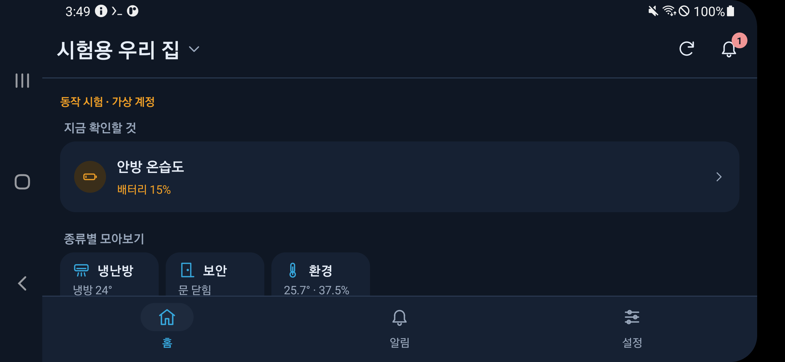
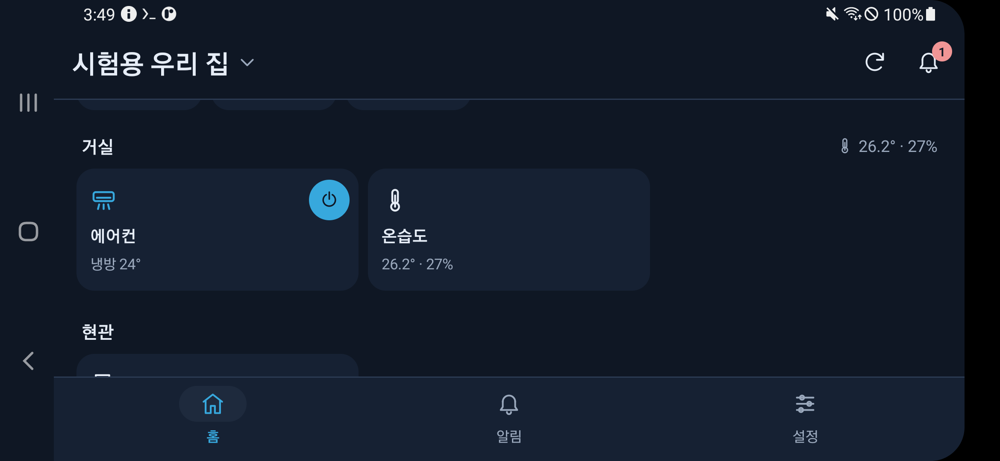
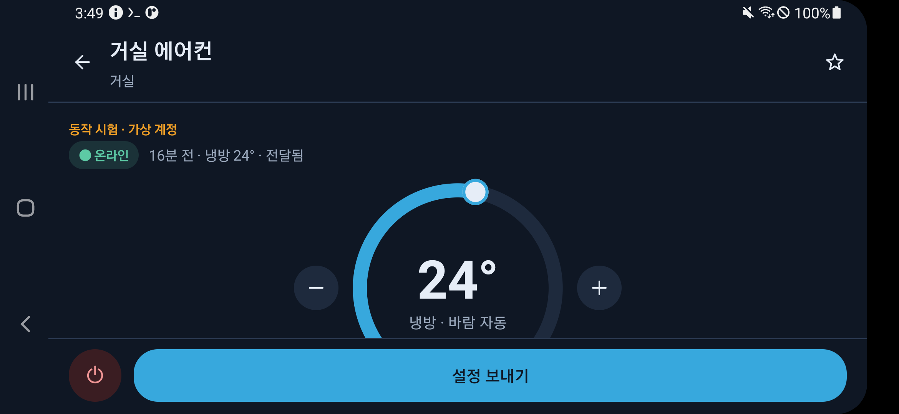
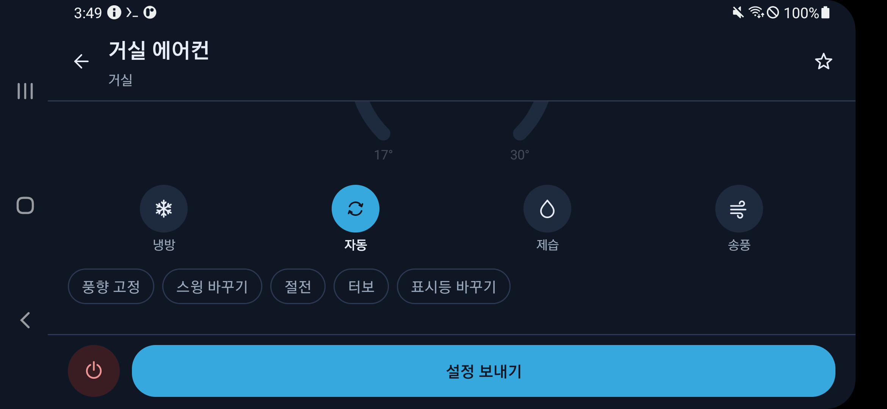
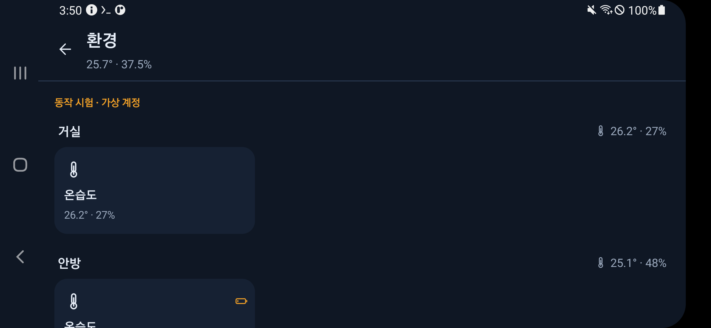
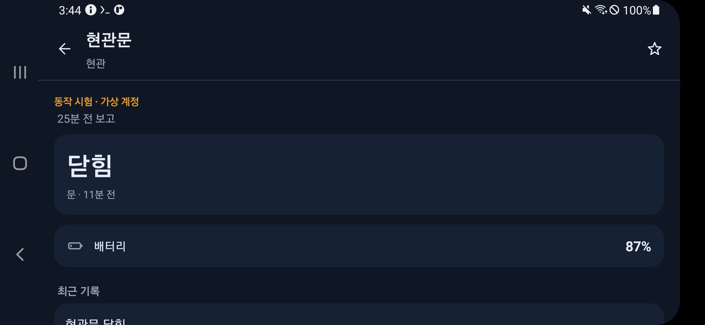
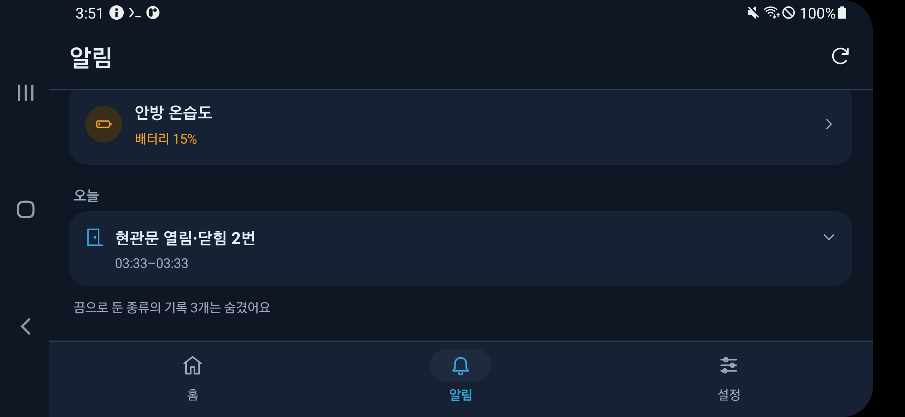
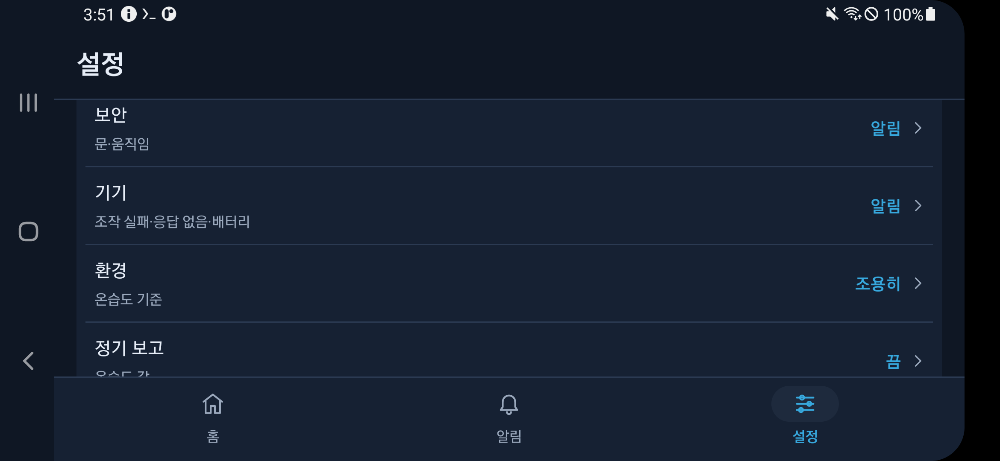
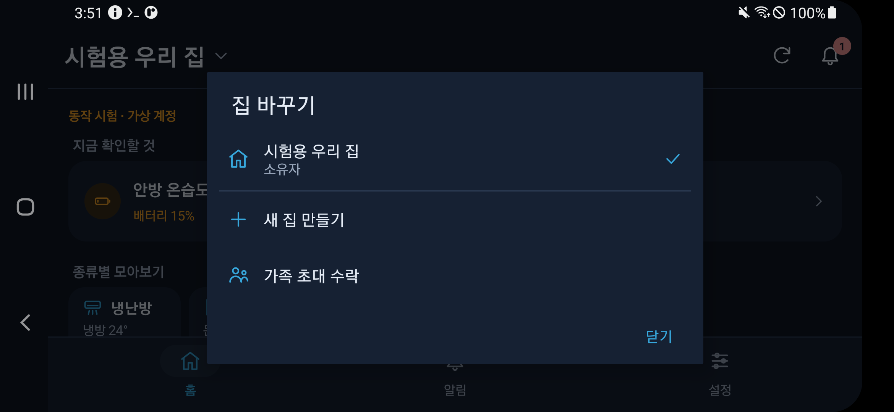

# 가족 스마트홈 Android 앱

현재 준비한 가족 앱은 0.6.1이다. 중앙 서버 0.7.0(스키마 7)의 기기 목록 API와 알림 중요도 API를 쓰고, 예전 0.6.0 서버에서도 그대로 동작한다. 어두운 색과 에어컨 온도 다이얼은 그대로 두고 화면 구조를 다시 짰다. 아래 0.6.1 화면 사진은 구조를 바꾼 뒤 A50에서 찍었다. A50이 옆으로 놓여 있어 가로 화면이다.

- 처음 화면: 로그인하면 집 목록을 거치지 않고 마지막으로 연 집(없으면 첫 집)을 바로 연다. 참여한 집이 없으면 새 집 만들기·가족 초대 수락·연결 설정만 보여준다. 위쪽 집 이름을 누르면 다른 집으로 바꾸거나 새 집을 만들거나 초대를 수락한다.
- 아래 탭은 홈·알림·설정 세 개다. 예전 기록 탭은 알림 탭으로 합쳤다. 기기·에어컨·종류별 화면과 가족 관리는 아래 탭 없이 뒤로 화살표로 돌아가고, 휴대폰의 뒤로 버튼도 앞 화면으로 돌아간다.
- 홈: 확인할 일이 있을 때만 ‘지금 확인할 것’이 맨 위에 나온다. 문 열림(몇 분째인지), 배터리 20% 이하, 6시간 넘게 보고가 없는 배터리 센서(응답 없음), Pi 연결 끊김·기기 목록이 10분 넘게 안 바뀜, 10분 안에 실패하거나 결과를 모르는 에어컨 명령, 해제되지 않은 자동화 경고를 앱이 계산한다. 그 아래에 종류별 모아보기(냉난방·조명·보안·환경·안전·전력·기타), 즐겨찾기, 공간별 3열 타일이 이어진다. 즐겨찾기는 이 휴대폰에만 저장하고 타일을 길게 누르거나 기기 화면의 별을 눌러 바꾼다. 위쪽 종 아이콘의 숫자는 확인할 것의 개수다.
- 기기 목록은 `GET /v1/homes/<home>/devices`로 읽는다. 서버가 404를 돌려주는 예전 버전이거나 Pi가 아직 목록을 보내지 않았으면 제어 목록의 에어컨과 최근 문·온습도 기록으로 기기를 만들어 보여준다. 에어컨이 켜졌는지는 마지막으로 보낸 명령에서 추정한 값이고 실제 상태를 읽은 값이 아니다.
- 에어컨 화면은 세로 화면(1080×2340)에서 스크롤 없이 한 화면에 들어가도록 줄였다. 이것은 계산한 값이고 세로 화면 실측은 아직이다. A50 가로 화면에서는 아래 부가 기능을 보려면 스크롤해야 한다. 연결 상태와 마지막 명령(예: 1분 전 · 냉방 24° · 전달됨)을 한 줄로 보여주고, 다이얼, 운전 모드, 바람, 부가 기능, 아래 고정한 끄기·설정 보내기 버튼을 둔다. 보내기 전 확인 창, 결과 확인, 절전은 냉방 중에만 된다는 안내, 조회 전용 제한은 그대로다. 문·온습도 센서와 아직 모르는 기기는 큰 숫자, 문 상태, 배터리, 그 기기의 최근 기록, 모르는 값의 이름·값 줄로 보여준다.
- 알림 탭: 종류 칩(전체·안전·보안·기기·환경·정기 보고·자동화·가족·기타)으로 거르고, 맨 위에 ‘해결 안 됨’, 그 아래에 오늘·어제·날짜별 기록을 둔다. 같은 날 같은 기기의 같은 종류 기록이 이어지면 ‘현관문 열림·닫힘 6번’처럼 한 줄로 접고 누르면 펼친다. 이 휴대폰에서 ‘끔’으로 둔 종류는 ‘전체’에서 숨기고 그 종류 칩을 누르면 보인다.
- 설정 탭: 이 휴대폰 알림(받기 스위치·연결 확인·시험 알림), 알림 종류별 중요도 7줄(긴급·알림·조용히·끔, 안전은 긴급·알림만), 정기 보고 간격(1·5·15·60분, 정기 보고가 긴급·알림일 때만), 방해 금지 시간(기본 23:00–07:00, 긴급 알림은 울린다), 집 관리(가족 초대·가족 관리·Pi 허브 연결·연결 해제·집 삭제), 연결 및 계정을 둔다. 동작 시험 앱은 알림을 받지 않는다는 안내를 그대로 둔다.
- 푸시: 중요도는 고르는 즉시 이 휴대폰에 저장하고 `PUT /v1/installations/<id>/notification-levels`로 일곱 종류를 모두 보낸다. 서버가 404면 예전 `/preferences`에 보안·정기 보고·자동화를 켬/끔으로 바꿔 보낸다. 0.6 앱에서 고른 문·온습도·경고 선택은 처음 한 번 보안·정기 보고·자동화의 알림/끔으로 옮긴다. FCM의 `alert_category`·`level`을 읽고, 없으면 예전 `category`로 종류를 정한다. 이 휴대폰에서 조용히·끔인 종류는 표시하지 않는다. 긴급은 새 ‘긴급 알림’ 채널(중요도 높음), 방해 금지 시간의 알림은 새 ‘방해 금지 시간 알림’ 채널(중요도 낮음), 정기 보고는 기존 온습도 채널을 쓰고, 같은 종류끼리 묶어서 보여준다. 알림 문구에는 지금처럼 기기 이름이나 값을 넣지 않는다.
- 확인한 범위: 단위 확인 88개(기존 40개 + 기기 목록·대체 목록·타일 문구·지금 확인할 것·기록 묶기·알림 종류와 중요도 48개)를 모두 통과했고, production·fixture 앱과 두 계측 테스트 묶음이 컴파일된다. A50에 동작 시험 앱을 설치해 홈·에어컨·종류별·센서 화면·알림·설정·집 바꾸기를 가로 화면에서 직접 눌러 봤다. 이때 한 줄에 기기가 3개보다 적으면 타일 높이가 0이 되는 문제와, ‘현관문’이 공간 이름 ‘현관’을 떼고 ‘문’으로 보이는 문제를 찾아 고쳤다. 세로 화면·TalkBack·실제 FCM 수신 확인은 아직 하지 않았다.

## 0.6.1 화면

---

동작 시험 앱(가상 계정·가상 집)을 A50에 설치해 실제로 찍은 화면이다. 기기 4개(거실 에어컨·거실 온습도·현관문·안방 온습도)와 배터리 15%는 화면 확인용 가상 값이다.

| 홈과 지금 확인할 것 | 공간별 타일 | 에어컨 | 운전 모드·부가 기능 |
| --- | --- | --- | --- |
|  |  |  |  |

| 종류별 모아보기(환경) | 문 센서 | 알림 탭 | 알림 종류별 중요도 | 집 바꾸기 |
| --- | --- | --- | --- | --- |
|  |  |  |  |  |

구조를 바꾸기 전 어두운 화면은 `30`~`35`번 사진으로 남겨 두었다.

0.6.0은 서버 지문 확인이 들어가 0.6.0 이상의 중앙 서버가 필요하다. 홈의 에어컨 카드에서 조작 화면을 열어 냉방 17–30°C·바람 자동/약/중/강, 자동·제습·송풍, 풍향 고정·스윙·절전·터보·표시등과 전원 끄기를 선택한다. 값 선택만으로 신호를 보내지 않고 설정 보내기를 눌러 요청한다. 집 소유자·가족만 조작하며 조회 전용은 보내기 버튼을 사용할 수 없다. 요청 대기·IR 송신 완료·만료·결과 불명 상태를 나눠 표시하고 명령은 자동 재전송하지 않는다. 실제 에어컨 상태를 읽은 값으로 표시하지 않는다. 단위 확인 28개와 APK 빌드·서명 확인을 통과했고, 이 버전의 실기기 화면·물리 반응 확인은 별도로 남긴다. [앱 제어 연결 순서](../../docs/aircon-app-control.md).

0.5.2에서는 화면 회전 뒤 조작 화면과 선택값을 유지하고 결과 대기가 화면을 막지 않게 했다. 빠르게 두 번 눌러도 한 번만 전송하며 절전이 냉방 중에만 동작하고 바람을 자동으로 바꾼다는 안내를 추가했다. 기존 앱 위에 같은 서명의 APK를 설치한다. 2026-10-13의 H2 온도표·재접속 수정은 펌웨어에도 있어 서버 배포만으로 H2에 적용되지 않는다.

0.4.1에서 집 목록을 불러오는 중·연결 실패·실제로 빈 목록인 상태를 구분했다. 연결 실패 때 다시 연결·연결 설정을 안내하고 같은 로그인 상태에서 이미 읽은 집은 마지막으로 확인한 목록이라고 표시한다. 계정·서버가 바뀌면 이전 목록을 지운다. 임시 HTTPS 주소 자체가 고정된 것은 아니다. [주소 오류와 집 목록 복구](../../docs/troubleshooting.md).

이전 0.4.0에서는 미등록/권한/충돌/한도/전송 제한 안내, 휴대폰별 문·온습도·경고 선택과 온습도 1·5·15·60분, 읽기 쉬운 기록·뒤로 가기·소유자 집 삭제 확인을 추가했다. 실제 A50의 기존 로그인 유지·화면 안내·백그라운드/화면 꺼짐 FCM 수신을 확인했다. [8편 재현 절차](../../docs/blog/mobile-app/08-notification-choices-and-home-management.md). 아래 초기 구축 설명은 이전 버전의 진행 순서다.

2026-10-02: Google 로그인·집 등록·가족 초대 화면 구현, 시험 APK 빌드·서명 검증,
Android 단위 검사 2개와 A50 실기기 UI/API 검사 2개 통과. Firebase 앱·두 지문 등록 완료.
실제 Firebase 구성 검증·production 개발/배포 APK 빌드·서명·시험 토큰 제외 검사 완료.
A50에 배포 APK를 설치하고 Firebase 초기화·로그인 시작 화면을 확인했다.
사용자가 다른 휴대폰에서 실제 계정 Google 로그인 성공을 확인했다.
이후 A50에서도 사용자 직접 Google 로그인·배포 APK의 HTTPS API 연결·실제 집 등록·
소유자 관리 화면·클라이언트 재실행 후 세션 유지 검사를 통과했다. 0.2.0에서는 FCM 수신 서비스·알림 설정·설치 등록·소유자 전용 시험 알림을 추가했다. 단위 검사 4개와 A50의 실제 설치 등록 시험을 통과했다. 전용 서버 키 연결 후 실제 FCM 콜백과 알림 게시를 백그라운드·화면 꺼짐 즉시 시험에서 각각 확인했다. 다른 가족 단말·장시간·실제 Pi 연결은 검증 전이다. 자세한 절차와 범위는 [블로그 6편](../../docs/blog/mobile-app/06-family-fcm-notifications.md)을 따른다.
기존 a50-manager와 독립된 앱이다. 결과는 블로그 4편·날짜별 기록에 남긴다.

## 준비물

- 이 저장소와 Windows의 Python 가상환경.
- Android 8 이상 휴대폰, Google 계정과 Google Play 서비스.
- 무료 Firebase 프로젝트의 Google 로그인 제공자.
- 기존 A50 SSH/ADB 관리 설정(실제 값은 .deploy/a50 아래, Git 제외).
- Google 로그인이 허용된 앱 서명 키와 Firebase Android 앱 등록.
- HTTPS 중앙 서버 주소. 현재 임시 Cloudflare Quick Tunnel을 실제 APK에서 사용한다. 터널 재시작 후 주소 변경에 유의한다.

## 재현 순서

1. 기존 A50 관리 준비·중앙 서버·가족 권한 단계를 블로그 1~3편 순서로 완료한다.
2. 로컬에서 `python scripts/android/prepare_family_tools.py`를 실행한다.
   공식 Android SDK 36·Build Tools 36.0.0·Platform Tools와 Gradle 8.13을 체크섬 검증 후 로컬 캐시에 설치한다.
   JDK 17은 앞선 관리 앱 빌드 도구를 재사용한다. 설치 도구가 SDK의 공식 라이선스 기록을 만든다.
   다른 환경에서는 JDK 17을 준비하고 `--java-home <JDK_17_절대경로>`를 지정하거나 JAVA_HOME을 설정한다.
3. `python scripts/android/prepare_family_signing.py`로 가족 앱 전용 서명 키를 만든다.
   기존 관리 앱의 키는 그대로 유지한다. 서명 키·비밀번호는 저장소 밖에서 보관한다.
4. Firebase Console → 프로젝트 설정 → Android 앱 추가.
   패키지 `com.aircon.family`, 닉네임 `가족 스마트홈`으로 등록한다.
   로컬 .deploy/family-app/signing.json의 공개 SHA-1·SHA-256 지문을 프로젝트의 앱에 추가한다.
   개인 키와 비밀번호를 업로드하지 않는다. 앱 패키지 이름은 이후 바꿀 수 없으므로 정확히 입력한다.
5. Firebase의 google-services.json을 받아 `.deploy/family-app/google-services.json`에 저장한다.
   Google OAuth 웹 클라이언트 ID가 포함된 최신 파일을 사용한다. 이 설정 파일은 Git에서 제외한다.
   `python scripts/android/import_family_firebase.py --source "<다운로드한 파일 경로>" --project-id <프로젝트 ID>`로
   프로젝트·Android 패키지·전용 SHA-1·웹 클라이언트를 확인하고 비공개 폴더에 복사할 수 있다.
6. `python scripts/android/build_family_app.py`로 단위 검사·개발/배포 APK를 빌드한다.
   소스는 로컬 android/family-app이 기준이며 빌드는 별도 ASCII 경로에서 수행한다.
   서명 키나 설정 파일을 앱 소스 폴더에 복사하지 않는다.
7. 결과는 `tmp/family-app-build/family-debug.apk`, `family-release.apk`이다.
   개발 APK는 같은 A50의 루프백 HTTP 주소만 시험용으로 허용한다.
   배포 APK는 HTTPS만 허용하며 소유자가 안내한 서버 주소를 설정해야 한다.
8. `python scripts/android/verify_family_apk.py`로 실제 서명·Firebase 구성 포함·시험 토큰 제외·
   manifest가 참조하는 HTTPS 정책을 검사한다.
9. 관리 연결이 준비된 A50에 설치하려면 아래 순서로 미리보기와 실제 반영을 구분한다.

```text
python scripts/android/install_test_family_app.py --production-only --release
python scripts/android/install_test_family_app.py --production-only --release --apply
```

2026-10-02 배포 APK 0.1.0: 3,888,953바이트.
SHA-256: `30842377eaaba3626b9dd80c7888a092e99227927f265e23d4c4a6e8406ca12b`.
실제 Google 계정이 있는 휴대폰에서 설치 후 ‘Google로 계속하기’를 선택한다.
로그인 뒤 서버 주소가 없으면 연결 설정 화면을 보여 준다. 현재 A50의 시험용 HTTPS 주소를
별도로 안내하며, 앱 소스·블로그에는 실제 주소를 넣지 않는다. 고정 운영 주소는 후속 준비다.

google-services.json의 앱 구성 정보는 APK 안에 포함되는 클라이언트 정보다.
Firebase 서버 관리 권한을 주는 서비스 계정 개인 키를 APK에 넣지 않는다.
Firebase 구성 값으로 집 권한을 부여하지 않고, 중앙 서버가 사용자 토큰과 현재 가족 등록을 검사한다.

## 앱 동작

- Google Credential Manager → Google ID 토큰 → Firebase Authentication 로그인.
- Firebase ID 토큰을 중앙 API에 보내 현재 집 목록을 가져온다. 토큰을 보내기 전에 서버가 서명한 신원 응답을 확인하고 처음 저장한 서버 지문과 비교한다.
- 새 집 만들기, 이메일과 역할로 초대 발급, 지정 계정의 초대 수락.
- 소유자만 가족 관리·역할 변경·참여 해제·기기 등록.
- 집·알림 기록 조회와 로그아웃. 계정 변경 뒤 오래된 응답은 화면에 반영하지 않는다.
- 인증·서버 장애 때 성공한 화면을 꾸미지 않고 오류를 표시한다. POST는 자동 재전송하지 않는다.
- FCM·Pi 연결 시험은 완료했다. 실제 물리 문/새 온습도 보고·다른 가족 계정·장시간 운용은 후속 검증이다.

## 서버 지문

앱은 Firebase ID 토큰을 보내기 전에 같은 주소로 `GET /v1/server-identity?nonce=<무작위 32자리 hex>`를 먼저 보낸다. 서버는 자기 공개 키(EC P-256)와 `aircon-central-identity\n<nonce>\n<host>\n<issued_at>`에 대한 ES256 서명을 돌려주고, 앱은 서명·호스트·발급 시각(±10분)·공개 키 SHA-256 지문을 확인한다. 하나라도 맞지 않으면 토큰을 보내지 않고 ‘서버 신원을 확인하지 못했어요’로 표시한다. 이 확인은 앱 프로세스마다 주소별로 한 번 하고, 주소가 바뀌거나 앱을 다시 켜면 다시 한다.

처음 연결할 때 지문을 휴대폰의 비공개 설정(`server` 환경설정, 키 `fingerprint`)에 저장하고 설정 화면과 연결 화면에 ‘서버 지문’(앞 16자리, 네 자리씩)으로 보여 준다. 소유자가 서버에서 출력한 지문과 같은지 비교해 주면 된다. 이후 임시 터널 재시작으로 주소가 바뀌어도 같은 키면 그대로 연결되고, 다른 키면 토큰을 보내지 않고 ‘서버 신원이 바뀌었어요’ 대화상자를 띄운다. ‘취소’는 저장된 지문을 유지하고, ‘이 서버로 바꾸기’를 눌러야만 새 지문으로 바꾼다. 로그아웃과 연결 주소 변경은 지문을 지우지 않는다.

막는 것: 한 번 연결한 뒤 누군가 다른 주소를 보내 토큰을 가로채려는 주소 바꿔치기. 막지 못하는 것: 맨 처음 연결에 잘못된 주소를 입력한 경우. 그래서 첫 연결 뒤 소유자와 지문을 비교해야 한다. 서버가 이 응답을 주지 못하는 이전 버전이면 모든 요청이 ‘서버 신원을 확인하지 못했어요’로 끝나므로 서버를 먼저 올려야 한다.

## 독립된 실기기 동작 시험

실제 Google 계정을 대신 조작하지 않는다. 원격 기기에 계정이 없으면 실제 로그인 시험은
사용자가 계정이 있는 휴대폰에서 실행할 때 확인한다.

```text
python scripts/android/prepare_family_fixture.py
python scripts/android/build_family_app.py --fixture-only
python scripts/android/verify_family_apk.py
python scripts/android/install_test_family_app.py
python scripts/android/install_test_family_app.py --apply
python scripts/android/stop_family_fixture.py
```

fixture 빌드는 별도 패키지 `com.aircon.family.fixture`와 가상 계정 표시를 사용한다.
시험 서버는 127.0.0.1:8765와 임시 저장소를 사용하며 운영 DB와 계정을 변경하지 않는다.
40분 후 스스로 종료한다. 실제 검증 코드는 시험용 RSA 서명과 집별 권한을 검사한다.
시험 토큰은 .deploy와 별도 fixture APK에만 포함하며 production APK에는 들어가지 않는다.
최종 시험 절차·결과·캡처는 완료한 실행에 근거해 기록한다.
실제 Google 구성 파일이 준비됐다면 `--fixture-only` 대신 `--tests`로 production APK도 빌드한다.
시험 뒤 fixture 서버를 종료하면 시험 APK의 화면 데이터 연결도 종료된다.

## 공식 문서

- [Firebase Android Google 로그인](https://firebase.google.com/docs/auth/android/google-signin)
- [Credential Manager Google 로그인](https://developer.android.com/identity/sign-in/credential-manager-siwg)
- [Firebase Android 설정](https://firebase.google.com/docs/android/setup)
