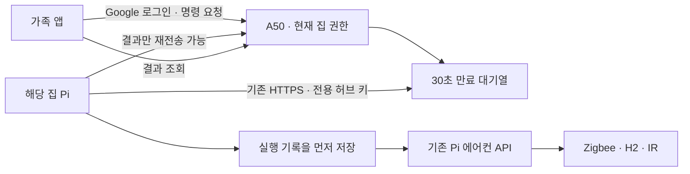

# 가족 앱에서 에어컨 조작하기

　알림을 받던 가족 앱에 에어컨 조작 화면을 추가했다. 현재 가족 앱은 0.6.2(공간별 홈과 어두운 다이얼 화면)이고 중앙 서버는 0.7.0, 중앙 저장소는 스키마 7이다. Pi에 등록된 Carrier CS-A061GS 에어컨에 H2 IR 송신 장치가 연결된 구성을 사용한다. 0.5.1의 앱 명령 연결에는 H2 재기록이 필요 없었다. 2026-10-13에 찾은 27·28°C 신호와 Zigbee 재접속 오류는 H2 펌웨어에도 수정이 있어 별도 반영이 필요하다. 이번 서버·앱 배포에서는 H2를 다시 기록하지 않았다.

## 버튼과 실행 결과

　집 화면의 에어컨 카드에서 **에어컨 조작**을 누른다. 운전 모드와 원하는 값을 고른 뒤 **설정 보내기 → 보내기**를 누른다. 값을 고르는 것만으로는 신호를 보내지 않는다. 홈에서도 **끄기**를 바로 선택할 수 있다. 처음 화면의 24°C·바람 자동은 선택 기본값이며 실제 에어컨에서 읽은 상태가 아니다.

| 조작 | 앱에서 고를 수 있는 값 |
| --- | --- |
| 냉방 | 17–30°C · 바람 자동/약풍/중풍/강풍 |
| 운전 모드 | 냉방/자동/제습/송풍 |
| 풍향 | 풍향 고정 · 스윙 동작 바꾸기 |
| 부가 기능 | 절전 · 터보 · 표시등 바꾸기 |
| 전원 | 전원 끄기 · 선택한 운전 설정으로 켜기 |

　자동·제습·송풍과 부가 기능은 기존 프로필에 저장된 신호를 보낸다. 온도와 바람 선택은 냉방에만 적용한다. 스윙과 표시등은 누를 때마다 동작이 바뀌는 명령이므로 확인 창에서 이 점을 안내한다. 전원 끄기는 토글을 사용하지 않는다. 실제 동작은 에어컨에서 확인한다.

　0.5.0에서는 냉방 24°C 켜기와 끄기만 연결했다. 사용자가 기존 Pi 웹의 나머지 조작도 필요하다고 알려줘 0.5.1에서 같은 H2 명령을 앱에 연결했다. 0.5.0의 두 요청도 계속 처리하므로 이전 APK에서 끄기·켜기를 쓰던 동작은 유지한다.

　집 소유자와 가족 계정은 조작할 수 있고 조회 전용 계정은 조작할 수 없다. 다른 집의 에어컨 ID를 넣어도 서버가 요청을 거절한다. 버튼을 숨기는 것에만 의존하지 않고 서버에서 현재 권한을 읽는다.

| 화면 상태 | 의미 |
| --- | --- |
| Pi 연결 끊김 | 최근 25초 안에 제어 연결 정보를 받지 못해 새 명령을 받지 않음 |
| Pi에 명령 전달 중 | 중앙 서버에 짧게 대기 중 |
| IR 송신 결과 기다리는 중 | 해당 집 Pi가 명령을 받아감 |
| IR 신호를 보냈어요 | 송신 장치가 전송 완료를 보고함. 실제 전원 상태를 측정한 값은 아님 |
| 시간이 지나 실행하지 않았어요 | 실행 전 30초 만료시간이 지남 |
| 실행 결과를 받지 못했어요 | 이미 IR을 보냈을 수도 있음. 다시 누르기 전에 실물을 확인함 |

## 전달 방식



　Pi는 기존의 외부 HTTPS 연결로 명령을 받아간다. Pi 제어 포트를 공용 인터넷에 열지 않는다. FCM은 기존 알림에 사용하고 에어컨 명령은 보내지 않는다. 앱은 명령 POST를 자동 재전송하지 않는다.

　중앙 서버는 한 번 Pi에 전달한 명령을 다시 전달하지 않는다. Pi도 실제 API 요청 전에 자신의 대기 DB에 명령 ID를 저장한다. 결과 보고만 네트워크 오류 후 다시 보낼 수 있다. Pi가 실행 중에 꺼졌다면 재시작 때 결과 불명으로 남기고 물리 명령을 반복하지 않는다. 대기 중에는 한 집에서 다음 명령을 받지 않으며 요청 간격도 제한한다.

　등록된 가족이나 허브를 해제하면 다음 명령부터 사용할 수 없다. 이미 전달되어 실행 중인 신호를 취소하거나 회수하는 기능은 아니다.

　중앙 서버와 Pi는 허용 목록의 명령만 전달한다. 냉방 요청은 `cool_24_auto`처럼 온도와 바람을 포함한 이름으로 고정하며, 17–30°C와 네 가지 바람 이외의 값은 거절한다. 앱이 보낸 URL이나 임의 JSON을 그대로 Pi API에 전달하지 않는다. 명령 이름만 확장하므로 기존 스키마 5의 집·가족·알림 데이터 구조는 바꾸지 않는다.

## 기존 설치 업데이트 순서

　PC에서 저장소의 `server` 폴더를 열고 자신의 SSH 연결과 Firebase·서명 설정을 준비한다. 기존 허브 연결이 완료된 Pi에 적용하는 순서다. `link_central_agent.py`를 다시 실행해 키를 새로 만들지 않는다. 원격 코드가 예상과 다르면 덮어쓰지 않고 먼저 차이를 확인한다.

```powershell
# 기존 서버 코드·터널과 등록 상태 확인
.venv/Scripts/python.exe scripts/android/verify_a50_tunnel.py
.venv/Scripts/python.exe scripts/pi/verify_central_agent.py

# 로컬에서 확인하고 앱 만들기
.venv/Scripts/python.exe -m pytest -q
.venv/Scripts/python.exe scripts/android/build_family_app.py
.venv/Scripts/python.exe scripts/android/verify_family_apk.py

# A50·Pi 코드 변경 미리보기
.venv/Scripts/python.exe scripts/android/deploy_a50_central.py
.venv/Scripts/python.exe scripts/pi/deploy_central_agent.py

# 데이터 백업 후 중앙 서버 갱신, 기존 독립 Pi 서비스 갱신
.venv/Scripts/python.exe scripts/android/deploy_a50_central.py --apply
.venv/Scripts/python.exe scripts/pi/deploy_central_agent.py --apply

# 현재 중앙 주소와 실제 Pi API를 읽어 연결 설정 미리보기
.venv/Scripts/python.exe scripts/pi/configure_control.py
.venv/Scripts/python.exe scripts/pi/configure_control.py --apply

# 반영 결과 확인
.venv/Scripts/python.exe scripts/android/verify_a50_tunnel.py
.venv/Scripts/python.exe scripts/pi/verify_central_agent.py
.venv/Scripts/python.exe scripts/pi/verify_control.py
```

　중앙 서버 배포 도구가 기존 DB를 일관된 상태로 백업하고 새 테이블만 추가한다. 집·가족·허브·FCM 설치·알림 선택은 유지한다. Pi 연결 설정 도구는 실행 중인 웹 서비스의 실제 사설 주소·8001 포트와 H2 연결을 먼저 읽는다. `control_origin`과 현재 중앙 HTTPS 주소만 비공개 설정에 넣고 기존 허브 키를 유지한다. 이전 설정도 비공개 백업으로 남긴다. 미리보기 이후 설정이 바뀌면 실제 반영을 중단한다.

　2026-10-15의 중앙 서버 0.6.0/스키마 6은 서버 신원 키(`server_identity` 테이블 1개, 키 1개)와 허브 이벤트 속도 제한·집별 이벤트 보존 상한·계정별 집·초대·설치 등록 상한을 추가한다. 5→6 갱신은 기존 집·가족·허브·알림 선택·명령 데이터를 유지하며 같은 배포 도구로 백업 뒤 반영한다. `scripts/pi/verify_control.py`는 스키마 5를 전제하므로 반영 뒤 6으로 맞춘다. 앱의 주소 고정과 지문 비교 방법은 [중앙 서버 README](../services/central-server/README.md)의 `python -m central_server.admin identity` 설명을 따른다.

　2026-10-16의 중앙 서버 0.7.0/스키마 7은 Pi가 보내는 기기 목록(`PUT /v1/hub/inventory`, 가족은 `GET /v1/homes/<home>/devices`)과 휴대폰별 알림 종류·중요도(`PUT /v1/installations/<id>/notification-levels`)를 추가한다. 6→7 갱신은 기존 휴대폰의 문·온습도·경고 선택을 보안·정기 보고·자동화 중요도로 옮기고 나머지 데이터를 그대로 둔다. 같은 날 Pi 연결 서비스 0.7.0이 에어컨·문 센서·온습도 센서 3개의 목록을 보내는 것을 A50 DB에서 확인했다. 형식은 저장소 루트의 `docs/decisions/0019-capability-inventory-and-alert-levels.md`에 정리했다.

　위 명령은 독립 연결 서비스만 업데이트한다. 2026-10-13에는 별도로 Pi 웹앱 18개 파일도 백업 후 배포하고 실행 설정을 갱신했다. 데이터는 유지하며 방화벽·포트 공개·H2 펌웨어는 바꾸지 않았다. 기존 알림은 연결 서비스가 새 측정값을 읽어 계속 보낸다.

　`tmp/family-app-build/family-release.apk`를 기존 가족 앱 위에 설치한다. 같은 서명을 쓰며 앱 삭제나 데이터 초기화를 하지 않는다. 실제 서명 키·Google 설정·운영 주소는 저장소에 포함하지 않는다. 시험용 임시 HTTPS 주소가 바뀌면 앱과 Pi의 주소를 모두 맞춰야 한다. 이 기능이 주소를 고정하는 것은 아니다.

## 확인 결과와 남은 일

　2026-10-13에는 루트 178개, 서버 327개(2개 건너뜀), 화면·변환기 54개, 가족 앱 단위 확인 22개가 통과했다. A50 중앙 서버·HTTPS 통로, Pi 웹앱·연결 서비스를 반영하고 소스 일치와 정상 응답, MQTT·SSE 연결을 확인했다. 임시 HTTPS 주소가 바뀌어 Pi도 새 주소로 연결했다. 사용자 앱의 연결 설정에도 새 주소를 저장해야 한다.

　0.5.2는 화면 회전 후 조작 화면과 선택값을 유지하고 결과 대기를 화면과 분리하며 중복 누르기를 막는다. 절전은 Pi에 저장된 마지막 냉방 설정을 기준으로 현재 온도·자동풍을 이어 보낸다. 실제 전원 상태를 센서로 읽는 기능은 아니다. H2의 온도표 수정은 펌웨어 반영 전이므로 27·28°C 냉방과 새 재접속 동작을 실제로 고쳤다고 표시하지 않는다. 새 APK의 실기기 화면과 실물 반응 확인도 남아 있다. 아래 내용은 10월 11일의 초기 연결 결과다.

　로컬에서는 실제 중앙 API와 별도 임시 DB를 사용해 집별 접근 차단, 조회 전용 거절, 권한 해제·기기 해제 후 명령 취소, 만료된 요청 차단, 중복 전달 차단, Pi 실행 중단 뒤 재송신하지 않는 동작을 확인했다. H2 송신 완료와 단순 모의 실행도 구분했다.

　0.5.1에서는 서버·Pi 자동 확인 216개가 통과했고 Windows에서 실행하지 않는 2개는 건너뛰었다. 허용된 66개 요청이 기존 Pi 명령으로 이어지는 것을 가짜 송신 장치로 확인했다. 잘못된 값·다른 집 접근·권한 해제·만료·중복·실행 중단도 확인했다. 이 자동 확인은 실물 IR 송신 시험과 구분한다.

　실제 A50과 Pi에 0.5.1을 반영한 뒤 기존 집·가족 등록, 저장 파일 정상 상태, 스키마 5, 제어 연결 정보와 에어컨 1대 등록을 확인했다. HTTPS 상태 확인은 200이었고 인증 없는 요청은 거절했다. 배포한 코드가 로컬과 같았고 기존 Pi 웹 서비스도 계속 실행 중이었다. APK의 단위 확인 13개, 기존 서명·HTTPS 정책·시험 자료 제외 확인을 통과했다.

　A50의 화면 연결은 실패해 새 앱 설치와 실기기 화면 캡처를 하지 못했다. 사용자는 아직 새 APK를 설치하지 않았다고 했다. 0.5.1을 기존 앱 위에 설치한 뒤 집 화면의 ‘에어컨 조작’에서 원하는 설정을 보내고 앱 결과와 실물 반응을 확인하는 일이 남았다. 이번 배포에서는 물리 명령을 보내지 않았다.
