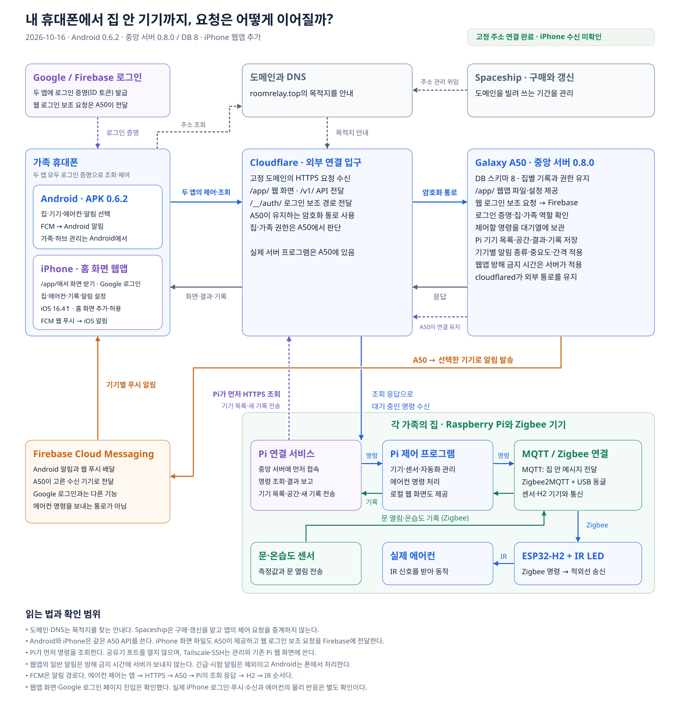

# 휴대폰 앱에서 집 안 기기까지 이어지는 연결

　Android 가족 앱과 iPhone 홈 화면 웹앱에서 에어컨을 누르면 **Cloudflare를 거쳐 A50에 요청을 보내고, 해당 집의 Pi가 명령을 가져가 실행한다.** 문 열림과 온습도 알림은 센서에서 시작해 A50을 지나 FCM으로 휴대폰에 도착한다. iPhone 웹앱의 화면 파일도 A50이 제공한다. 아래 그림은 두 앱의 로그인·제어·알림 경로를 함께 보여준다.

　2026년 10월 16일 코드 기준이다. Android 앱은 0.6.2, 중앙 서버는 0.8.0·DB 스키마 8, Pi 연결 서비스는 0.7.0이다. 고정 주소 연결과 웹앱 화면·Google 로그인 페이지 진입은 확인했다. 실제 iPhone 계정 로그인과 푸시 수신은 아직 확인하지 않았다. Android 앱은 연결 설정에서 `https://roomrelay.top`을 저장하고, iPhone은 Safari에서 `https://roomrelay.top/app/`을 홈 화면에 추가해 연다.

[확대할 수 있는 벡터 그림](architecture/connection-flow.svg) · [블로그용 PNG](architecture/connection-flow.png)

## 각 부분이 맡은 일

---

| 구성 요소 | 쉬운 설명 | 이 프로젝트에서 하는 일 |
| --- | --- | --- |
| Android 가족 앱 | APK로 설치하는 화면 | Google 로그인, 집 선택, 에어컨 조작, 알림 선택, 기록 조회와 소유자 관리 |
| iPhone 홈 화면 웹앱 | Safari에서 홈 화면에 추가하는 화면 | 같은 집·기기·알림 API 사용. 가족 초대·허브 관리 등은 Android 앱에서 한다 |
| `roomrelay.top` | 서버를 찾아갈 고정 주소 | 앱과 Pi가 같은 주소를 계속 사용하도록 한다 |
| DNS | 주소를 어디로 찾아가야 하는지 알려주는 안내 | 접속할 때 Cloudflare의 인터넷 주소를 알려준다. 매 명령을 저장하거나 실행하지 않는다 |
| Spaceship | 도메인을 산 곳 | 등록 기간과 갱신을 관리한다. 앱의 제어 요청이 이 회사를 거쳐 가는 것은 아니다 |
| Cloudflare | 인터넷에서 요청을 받는 입구 | HTTPS 요청을 받고 A50이 유지하는 터널로 전달한다 |
| A50 중앙 서버 | 계정과 집을 관리하고 웹 화면도 내주는 서버 | 웹앱 파일과 로그인 보조 경로 제공, 가족 권한 확인, 명령·기기 목록·기록 저장, 웹앱 방해 금지 시간 적용 |
| Pi 연결 서비스 | 집에서 중앙 서버에 연락하는 프로그램 | 자기 집 명령 조회, 실행 결과와 기기 목록·공간·상태·새 기록 전송 |
| Pi 제어 프로그램 | 집 안 기기를 움직이는 프로그램 | 기존 에어컨 API와 센서·자동화 처리 |
| MQTT와 Zigbee2MQTT | 집 안 프로그램과 무선 기기를 잇는 통로 | USB 동글을 통해 센서·H2와 메시지를 주고받는다 |
| H2와 IR LED | 에어컨 앞의 작은 리모컨 | Zigbee 명령을 받아 적외선 신호를 보낸다 |
| Firebase Authentication | Google 계정 로그인 확인 | 앱에 로그인 증명인 ID 토큰을 발급한다 |
| FCM | 휴대폰 알림 배달 | A50이 고른 기기의 Android 알림이나 웹 푸시를 전달한다 |

## iPhone에서 처음 열었을 때

---

　Safari에서 `/app/`을 열면 도메인 → Cloudflare → A50 순서로 웹 화면을 받는다. 홈 화면에 추가한 뒤 아이콘으로 열어 Google 로그인한다. 웹앱은 Android와 같은 A50 API에 로그인 증명을 넣어 요청한다. 앱 화면 파일을 받았다는 이유만으로 다른 집의 기록을 볼 수 있는 것은 아니다.

　웹 로그인의 보조 요청인 `/__/auth/`는 A50이 설정된 Firebase 프로젝트로 전달한다. 로그인 도메인을 웹앱과 같게 두는 방식이며, 요청자가 임의의 다른 서버 주소를 전달하도록 만들지 않았다. [iPhone 설치 순서](ios-web-app.md)에 소유자 초대부터 홈 화면 추가·알림 허용까지 정리했다.

## 앱에서 에어컨을 눌렀을 때

---

1. 앱은 Google 로그인으로 받은 증명을 요청에 넣는다. DNS로 `roomrelay.top`의 목적지를 알아낸 뒤 HTTPS로 접속한다. DNS 조회 결과는 잠시 저장해서 재사용할 수 있다.
2. Cloudflare는 HTTPS 요청을 받은 뒤 A50의 `cloudflared`가 먼저 만들어 둔 암호화 통로로 전달한다. Cloudflare도 이 구간의 요청을 처리하는 서비스다. A50 내부의 중앙 API는 `127.0.0.1:8001`에서 실행된다.
3. A50은 로그인 증명과 현재 집의 가족 역할을 확인한다. 조작할 권한이 있으면 해당 집의 명령 대기열에 넣는다. 명령에는 만료 시간이 있어서 늦게 도착한 명령을 계속 실행하지 않는다.
4. Pi 연결 서비스는 중앙 서버에 주기적으로 명령이 있는지 물어본다. **A50이 공유기 안의 Pi에 새로 접속하는 방식이 아니라, Pi가 보낸 요청의 응답으로 명령을 받는다.**
5. Pi는 기존 제어 API로 명령을 실행한다. MQTT → Zigbee2MQTT → USB 동글 → H2 → IR LED 순서로 에어컨까지 전달된다.
6. Pi는 실행 결과를 A50에 보고하고 앱은 그 결과를 조회한다. IR 신호를 보냈다는 결과와 에어컨이 실제로 켜졌다는 확인은 구분해야 한다. 현재 에어컨이 자신의 상태를 다시 보내 주는 구조는 아니다.

## 문 열림이나 온습도 알림이 올 때

---

　센서가 Zigbee로 기록을 보내면 Pi가 저장한다. Pi 연결 서비스는 새 기록을 A50에 올린다. A50은 현재 집·가족 권한과 기기별 알림 종류·중요도·온습도 간격을 확인해 FCM에 전달을 요청한다. Android는 설치한 앱이 알림을 표시하고, iPhone은 홈 화면 웹앱이 웹 푸시를 표시한다. 이때 알림 권한과 휴대폰 네트워크 상태도 영향을 준다.

　iPhone 웹앱의 일반 알림은 방해 금지 시간에 A50이 보내지 않는다. 나중에 한꺼번에 보내도록 쌓아 두는 방식은 아니다. 긴급 알림과 연결 시험 알림은 예외다. Android 앱은 지금처럼 휴대폰에서 방해 금지 시간을 처리한다. iPhone의 실제 수신 결과는 아직 확인하지 않았다.

　같은 Google 계정으로 두 휴대폰에 로그인해도 알림 선택은 휴대폰마다 따로 저장된다. 다른 집의 알림은 집별 권한으로 차단한다. 도메인을 안다는 것만으로 집에 가입하거나 기기를 조작할 수는 없다.

## 서버가 다시 켜지면

---

　고정 연결을 마치면 A50의 터널 프로그램이 다시 접속해도 이름이 같은 터널과 도메인을 사용한다. 집·가족·기록은 A50의 SQLite 저장 파일에 남는다. 이전에 임시 주소가 바뀌어 집이 안 보였던 문제는 서버 연결 실패였고, 주소를 바꾸자 기존 집이 다시 보였다.

　고정 주소가 있어도 A50의 전원이나 인터넷이 끊기면 외부 앱에서 중앙 서버를 사용할 수 없다. 집 안 Pi와 기존 로컬 제어는 별도로 돌아간다. 앱을 통한 외부 제어와 중앙 알림 전달은 A50 연결이 복구된 뒤 다시 사용할 수 있다.

## Tailscale과 노트북의 위치

---

　Tailscale과 SSH는 장비 관리와 기존 Pi 웹 화면 접속에 사용한다. 가족 앱 사용자가 집마다 Tailscale에 가입하는 구조는 아니다. 공유기에서 Pi의 `8001`, MQTT, Zigbee 관리 화면을 공용 인터넷에 열지 않는다.

　노트북은 코드 수정·배포·화면 캡처에 사용한다. 고정 터널과 Pi 연결을 각 장비에서 실행하면, 가족 앱 요청이 매번 노트북을 경유하지 않는다.

## 더 자세히 볼 코드

---

- [A50 중앙 서버](../services/central-server/)의 로그인·집·명령 API
- [A50 외부 연결](../services/central-tunnel/)의 감독 실행과 재시작 제한
- [Pi 연결 서비스](../services/pi-central-agent/)의 명령 조회와 센서 기록 전송
- [Android 가족 앱](../android/family-app/)의 로그인·요청·알림 화면
- [iPhone 웹앱과 로그인 보조 경로](../services/central-server/central_server/web_app.py), [웹앱 화면 코드](../services/central-server/central_server/webapp/index.html)

　Cloudflare 터널은 서버 쪽에서 먼저 연결을 만들고, 공개 주소의 요청을 그 연결로 전달한다. 설치 화면과 이름은 서비스 업데이트에 따라 달라질 수 있다. [Cloudflare 공식 터널 안내](https://developers.cloudflare.com/cloudflare-one/networks/connectors/cloudflare-tunnel/get-started/create-remote-tunnel/).
