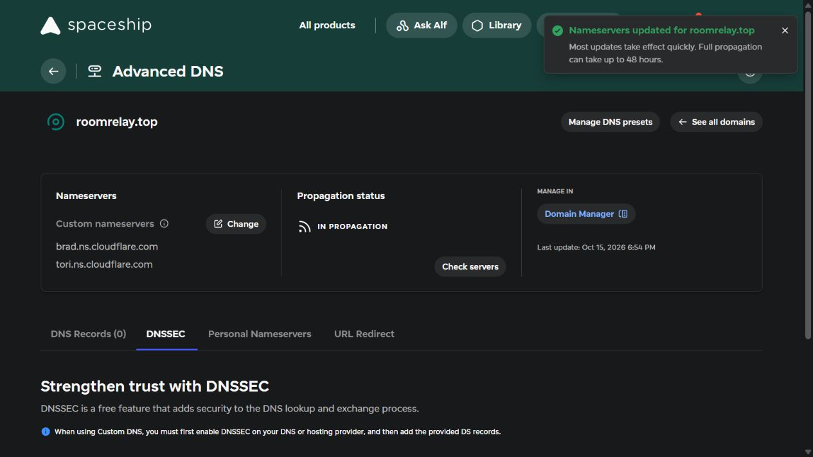
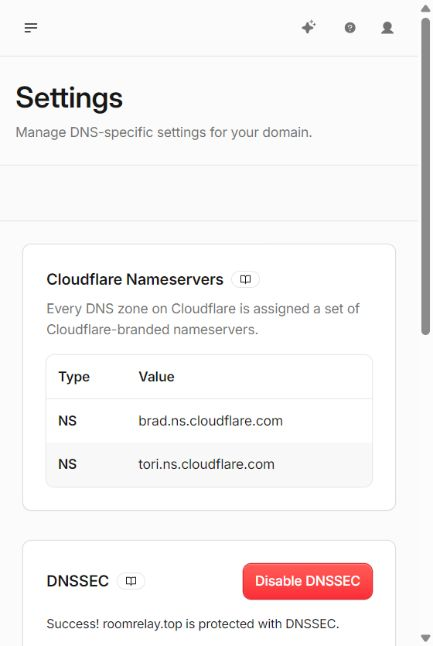

# A50 서버에 고정 주소 붙이기

　`roomrelay.top`을 앱과 Pi의 접속 주소로 쓰기 위해 Cloudflare의 이름이 있는 터널을 준비했다. 도메인 구매는 Spaceship에서 했고, 서버 프로그램과 데이터는 A50에 그대로 둔다. 노트북은 설정과 배포에 사용한다.

## 현재 진행 상태

---

　2026년 10월 15일 도메인 구매부터 고정 주소의 HTTPS·Pi 연결·DNSSEC 재연결까지 확인했다. 고정 터널을 다시 시작해도 같은 주소로 접속됐다. 기존 집 두 개와 허브 한 개가 유지됐으며 Pi의 명령 조회도 정상으로 확인됐다. 에어컨에 실제 명령은 보내지 않았고 A50 전체 재부팅도 이번에는 하지 않았다. 사용자 휴대폰 앱에서는 연결 주소를 한 번 바꿔야 한다.

## 도메인 구매와 주소 관리

---

　Spaceship에서 `roomrelay.top`을 1년 등록했다. 실제 구매 합계는 1.60달러였고 자동 갱신과 무료 개인정보 보호가 켜져 있었다. 당시 갱신 표시 금액은 기본 3.85달러에 ICANN 비용 0.20달러가 더해진 4.05달러였다. 환율·세금·판매처 가격에 따라 이후 실제 금액은 달라질 수 있다. 메일이나 웹호스팅 체험은 신청하지 않았다.

　Cloudflare는 기존 계정에서 Add a domain → Connect a domain으로 추가하고 Free 플랜을 골랐다. Cloudflare가 배정한 네임서버 두 개를 Spaceship의 Nameservers → Custom nameservers에 넣었다. **따라 하는 사람은 자신의 Cloudflare 화면에 나온 값을 사용한다.** 이 프로젝트의 이름을 그대로 복사하지 않는다.

　구매 직후 DNSSEC가 켜져 있었다. 이전할 때는 먼저 기존 DS를 제거하고 그 기록이 만료된 것을 확인한 뒤 네임서버를 바꿔야 한다. 이전 DS가 남은 DNS에서는 SERVFAIL이 생길 수 있다. 이번에는 네임서버 저장 직후 PC에서 DNS 서버 오류가 나왔고, 별도 공개 DNS 조회에서는 새 네임서버와 이전 DS가 없는 결과를 받았다. 새 주소가 모든 통신사에서 즉시 동작한다고 판단하지 않았다. [DNSSEC 이전과 재설정 공식 안내](https://developers.cloudflare.com/dns/dnssec/).

## A50 터널과 공개 경로

---

　Cloudflare의 Networking → Tunnels에서 `roomrelay-a50`을 만들었다. 기존 A50에 설치된 공식 Termux 패키지의 `cloudflared`를 사용했고, Windows 설치 명령을 A50에서 그대로 실행하지 않았다. 연결 키는 파일로 읽도록 준비했다. 키 내용·계정 이메일·터널 식별값은 이 문서에 넣지 않았다.

　로컬 도구의 미리보기 뒤 새 `aircon-fixed-tunnel` 서비스를 배포했다. 기존 임시 터널과 중앙 API는 계속 실행했다. Cloudflare 화면에서 Healthy와 Android arm64 연결을 확인했다. Published application 경로에 도메인을 선택하고 Service URL을 `http://127.0.0.1:8001`로 넣었다. 이 주소의 `127.0.0.1`은 터널이 실행 중인 **A50 자신**이다. Pi나 노트북 주소를 넣지 않는다.

　공개 경로를 저장하자 성공 안내와 함께 DNS 기록을 자동 생성하지 못했다는 경고가 나왔다. 도메인 구매 뒤 생긴 기본 안내 페이지용 A 기록 두 개가 같은 이름을 사용하고 있었다. 원래 값을 비공개 복구 자료에 남긴 뒤 두 기록을 터널용 CNAME으로 바꿨다.

| DNS 항목 | 넣은 값 |
| --- | --- |
| Type | `CNAME` |
| Name | `@` — 구매한 기본 도메인 |
| Target | 본인 터널 ID 뒤에 `.cfargotunnel.com`을 붙인 값 |
| Proxy status | `Proxied` |
| TTL | `Auto` |

　CNAME과 터널의 Published application 경로가 모두 있어야 한다. 터널이 Healthy라고 표시되는 것만으로 도메인의 HTTPS 연결까지 끝난 것은 아니다. [터널용 DNS 기록 공식 안내](https://developers.cloudflare.com/cloudflare-one/networks/connectors/cloudflare-tunnel/routing-to-tunnel/dns/).

## 실제 접속과 데이터 확인

---

　`server/`에서 `scripts/android/verify_a50_tunnel.py --fixed --hostname roomrelay.top`을 실행해 HTTPS 인증서, 중앙 API 준비 상태와 인증 없는 접근의 차단을 확인한다. 이 도구는 전부 통과한 뒤에만 Pi 설정 도구가 읽을 주소 파일을 갱신한다. 기존 주소 사본도 남긴다.

　같은 서버의 주소만 바꾸므로 집이나 허브를 새로 만들 필요가 없다. Pi에는 기존 허브 키를 보존하고 주소만 갱신하는 도구를 사용한다. 앱도 연결 설정에서 새 주소를 저장하고 같은 Google 계정으로 다시 로그인한다. APK를 새로 설치해야 하는 변경은 아니다.

　처음에는 터널 연결만 된 상태에서 HTTPS 확인을 실행해 통과하지 못했다. DNS 충돌을 해결한 뒤 다시 실행하니 준비 상태는 `200`, 로그인 없는 집·계정 조회와 잘못된 토큰 요청은 `401`로 차단됐다. 준비 응답과 인증 오류에는 `no-store`가 있어 저장된 응답을 재사용하지 않는 것도 확인했다.

　Pi에서는 Python의 기본 요청 표시로 보낸 준비 확인이 `403`으로 거절됐고, 우리 프로그램 이름을 표시한 요청은 `200`으로 응답했다. 정확히 어떤 Cloudflare 내부 규칙이 처리했는지까지 확인한 것은 아니다. 보안 기능을 끄지 않고 알림 전송·명령 조회 요청에 `FamilySmartHome-Pi/0.5.1`을 넣었다. 기존 운영 코드에서 이 두 요청만 바꾼 로컬 릴리스를 따로 준비해 배포했다. 아직 배포하지 않은 다른 로컬 알림 수정은 그대로 남겼다.

　Pi의 기존 설정을 미리 읽은 뒤 허브 키를 유지하고 주소만 바꿨다. 연결 서비스는 24초 동안 계속 실행 상태였고 중앙 서버에서 활성 허브 한 개와 제어 기기 한 개를 확인했다. 센서 DB와 기존 Pi 웹앱은 이번 주소 변경으로 교체하거나 다시 시작하지 않았다.

　고정 터널을 한 번 다시 시작했다. 확인 스크립트에 모듈 가져오기가 빠진 부분은 수정했다. Android에는 `/proc`의 자식 프로세스 목록 파일이 없어 `ps`로 부모·자식 관계를 읽어 이어서 확인했다. 새 프로세스의 주소가 같고 키가 명령행에 들어가지 않은 것을 확인했다. 파일 소유자만 읽는 권한도 A50에서 확인했다. PC에서 임시로 썼던 키 전송 파일은 확인 후 제거했다.

## DNS 보안도 다시 연결했다

---

　Cloudflare의 DNS → Settings → Enable DNSSEC에서 새 DS 정보를 읽었다. Spaceship의 Advanced DNS → DNSSEC → Add DS record에 Key Tag·Algorithm·Digest Type·Digest를 그대로 넣었다. 이 값은 개인 비밀 키가 아니지만, 독자는 자신의 도메인에서 나온 값을 사용해야 한다. 복사 과정에서 숫자나 글자 하나라도 다르면 접속 문제가 생길 수 있다.

　Spaceship의 저장 성공 문구와 Cloudflare의 `Success! ... is protected with DNSSEC` 문구를 확인했다. 별도 공개 DNS 조회에서도 DS 기록이 하나 있고 주소 응답에 인증된 데이터 표시가 있는 것을 확인했다.

## 앱에서 한 번 바꿀 설정

---

1. 가족 앱의 **연결 설정**을 연다.
2. 중앙 서버 주소를 **`https://roomrelay.top`**으로 저장한다. 포트 번호나 `/health/ready`를 뒤에 붙이지 않는다.
3. 같은 Google 계정으로 다시 로그인하고 기존 집이 보이는지 확인한다.

　이번에는 APK 코드를 바꾸거나 새 설치 파일을 만들지 않았다. 사용자 휴대폰에서 주소를 바꾼 뒤의 화면과 실제 알림·에어컨 반응은 별도 확인이 필요하다. 전환하는 동안 이전 앱을 쓰는 휴대폰이 바로 끊기지 않도록 기존 Quick Tunnel은 켜 두었다. 기존 임시 주소를 계속 쓰면 그 터널이 다시 시작될 때 주소가 바뀌는 문제는 남는다.

## 따라 할 코드와 연결 그림

---

　실행 명령과 A50 경로, 중지·재시작 방법은 [외부 연결 프로그램 안내](../services/central-tunnel/README.md)에 모았다. 블로그에 옮길 때는 코드 저장소 링크와 공개용 사진을 사용하고, 이 Markdown의 로컬 사진 경로를 티스토리 HTML의 `src`에 그대로 넣지 않는다.

　[각 구성 요소의 역할과 요청 순서](connection-flow.md)도 함께 읽는다. 앱 제어와 FCM 알림, Tailscale 관리 경로를 구분해 그렸다.
