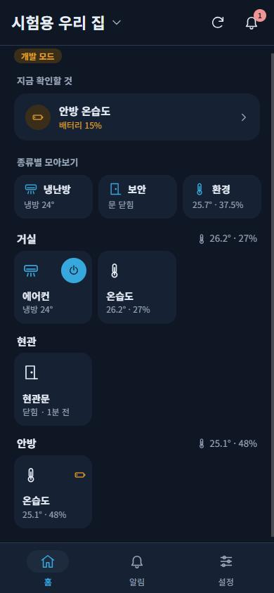
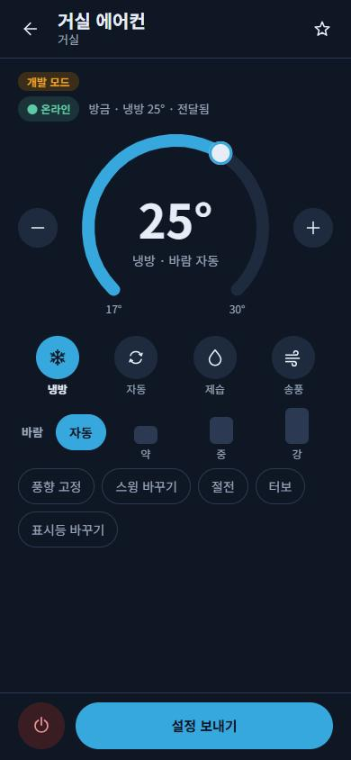
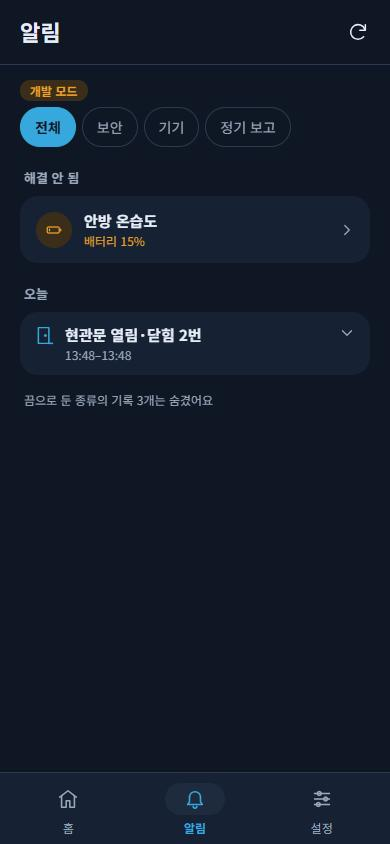
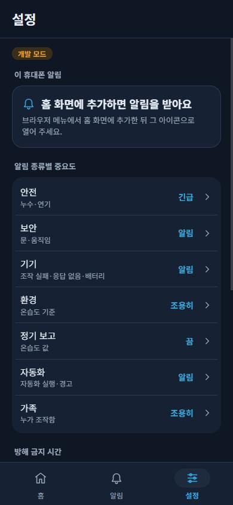

# iPhone 가족용 웹앱

　iPhone을 쓰는 가족은 Android 앱 대신 `https://roomrelay.top/app/`을 Safari로 열고 홈 화면에 추가해서 쓴다. A50 중앙 서버(0.8.0 이상)가 웹앱 파일을 직접 내주므로 별도 호스팅, Apple 개발자 등록, Mac이 필요 없다. 화면과 알림 규칙은 Android 가족 앱과 같다. 가족 초대·허브 연결·집 삭제 같은 소유자 관리는 Android 앱에서 한다.

## 집 소유자가 한 번 할 일

　Google 로그인이 `roomrelay.top`에서 동작하려면 콘솔에서 세 가지를 바꿔야 한다. 모두 무료이고 결제 수단이 필요 없다.

1. **Firebase 웹 앱 등록:** Firebase 콘솔 → 프로젝트 설정 → 일반 → 내 앱 → 앱 추가 → 웹(`</>`)을 고른다. 별칭은 `가족 스마트홈 웹`처럼 정하고, Firebase 호스팅은 켜지 않는다. 등록 뒤 나오는 `firebaseConfig` 내용을 복사해 둔다.
2. **로그인 허용 도메인:** Firebase 콘솔 → Authentication → 설정 → 승인된 도메인 → 도메인 추가에서 `roomrelay.top`을 넣는다.
3. **OAuth 리디렉션 주소:** Google Cloud 콘솔 → API 및 서비스 → 사용자 인증 정보 → OAuth 2.0 클라이언트 ID에서 `Web client (auto created by Google Service)`를 연다.
   - 승인된 JavaScript 원본에 `https://roomrelay.top`을 넣는다.
   - 승인된 리디렉션 URI에 `https://roomrelay.top/__/auth/handler`를 넣고 저장한다.
   - 웹 API 키에 HTTP 리퍼러 제한을 걸어 두었다면 `https://roomrelay.top/*`도 허용 목록에 넣는다.

　그다음 PC에서 복사한 설정을 A50 비공개 설정에 넣는다. 값은 저장소와 기록에 남기지 않는다. 처음에는 미리보기로 프로젝트가 서버와 같은지 확인하고, `--apply`로 반영한다. 반영하면 중앙 서버가 몇 초 동안 다시 시작한다.

```bash
cd server && ../.venv/Scripts/python.exe scripts/android/set_a50_web_config.py
```

```bash
cd server && ../.venv/Scripts/python.exe scripts/android/set_a50_web_config.py --apply
```

　도구를 실행하면 붙여넣기 창이 뜬다. `firebaseConfig` 내용을 그대로 붙여넣고 확인을 누른다.

## iPhone에서 설치하기

1. 집 소유자가 Android 앱에서 가족이 사용할 Google 계정으로 초대를 만든다. 초대 코드를 가족에게 알려준다.
2. 가족의 iPhone에서 Safari로 `https://roomrelay.top/app/`을 연다.
3. 공유 버튼 → 홈 화면에 추가를 누른다.
4. 홈 화면에 생긴 `스마트홈` 아이콘으로 앱을 열고 Google 로그인을 한다. Safari에서 미리 로그인했더라도 홈 화면 앱에서 로그인 상태를 다시 확인한다.
5. 초대받은 Google 계정으로 초대 코드를 넣어 집에 참여한다.
6. 설정 탭 → 이 휴대폰 알림에서 알림 받기를 누르고 허용한다. iOS 16.4 이상이어야 한다.

　이 안내는 Safari 기준이다. 다른 브라우저에서도 홈 화면 추가를 제공할 수 있지만, 알림 허용은 추가한 홈 화면 앱 안에서 해야 한다. 홈 화면 웹앱의 알림 조건은 [WebKit 공식 안내](https://webkit.org/blog/13966/webkit-features-in-safari-16-4/)에서 확인했다. 로그인 보조 경로는 [Firebase의 리디렉션 로그인 안내](https://firebase.google.com/docs/auth/web/redirect-best-practices)에 따른다.

## 알아둘 점

- 알림은 iOS 16.4 이상에서 홈 화면 아이콘으로 연 웹앱만 받는다. Safari 탭에서는 오지 않는다.
- iPhone 웹 알림은 받은 뒤 숨길 수 없다. 그래서 방해 금지 시간은 서버가 휴대폰 시각 기준으로 확인해 알림 단계 알림을 보내지 않는다. 긴급 알림은 그 시간에도 온다.
- 알림 문구에는 Android와 마찬가지로 기기 이름이나 측정값을 넣지 않는다. 자세한 내용은 앱을 열어 확인한다.
- 웹앱의 서버 신뢰는 `roomrelay.top` 주소와 HTTPS 인증서로 정한다. Android 앱처럼 서버 지문을 따로 고정하지 않는 이유는 웹앱 파일 자체를 같은 서버가 내주기 때문이다.

## 화면

　PC에서 가상 데이터 서버와 개발용 토큰으로 아이폰 크기(390×844)에 맞춰 찍은 화면이다. 개발용 토큰은 `127.0.0.1`·`localhost`에서만 동작하고 화면에 `개발 모드` 표시가 붙는다.

| 홈 | 에어컨 | 알림 | 설정 |
| --- | --- | --- | --- |
|  |  |  |  |
